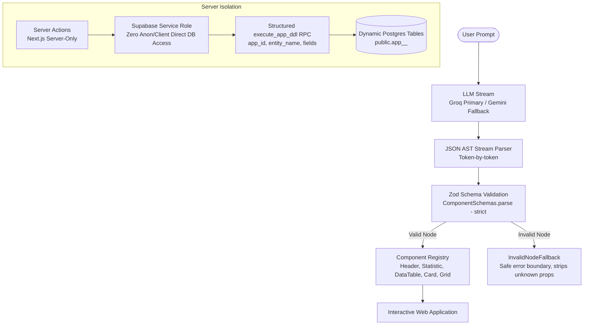

# AppForge

> AppForge is an AI-powered full-stack application generator that compiles conversational natural language prompts into type-safe, validated UI components backed by server-isolated dynamic Postgres databases.

**Live Application Link:** [TODO: live link]

---

## Architecture Overview

AppForge decouples user-facing UI generation from database persistence through a multi-tier pipeline:



### Key Architectural Pillars
1. **Streaming AST Generation & Validation**:
   - The Copilot LLM produces a raw JSON AST array.
   - Streamed nodes pass through strict Zod validators (`ComponentSchemas.parse()`) with `.strict()`, rejecting unwhitelisted attributes (`dangerouslySetInnerHTML`, `onClick`, `style`, arbitrary attributes).
   - Component rendering is isolated: invalid nodes degrade to `InvalidNodeFallback` without crashing sibling nodes.
2. **Server-Only Database Access via Service Role**:
   - Client applications never connect directly to Supabase (`anon` key access to core and dynamic tenant tables is completely locked down with PostgreSQL RLS error `42501`).
   - All database reads and writes execute through server actions (`lib/insforge-server.ts`) authenticated via Clerk server-side tokens and authorized via `authorizeAppAccess`.
3. **Structured Per-App DDL Isolation**:
   - Dynamic tables are created and altered exclusively via the structured PostgreSQL RPC `execute_app_ddl(app_id, entity_name, fields)`.
   - Raw SQL execution has been permanently eliminated. All identifiers are whitelisted, column names checked, and types restricted to `TEXT`, `NUMERIC`, `BOOLEAN`, and `TIMESTAMPTZ`.

---

## How to Run Tests

### Prerequisites & Safety Guard
Database tests are strictly permitted to run ONLY against the dedicated **TEST** Supabase project. A centralized safety guard in `tests/setup-db.ts` verifies that `TEST_SUPABASE_URL` explicitly contains the test project reference `dvkmkubcplroecqkfjuf`. If missing or pointing to any other project, test execution is immediately aborted.

Configure `.env.test` with your test database credentials:
```bash
TEST_SUPABASE_URL=https://dvkmkubcplroecqkfjuf.supabase.co
TEST_SUPABASE_SERVICE_ROLE_KEY=your_test_service_role_key
```

### Test Commands
```bash
# Run unit test suite (150 tests across 16 files)
npm run test:unit

# Run database & security hardening test suite (42 tests against dedicated TEST database)
npm run test:db

# Run full TypeScript typecheck
npx tsc --noEmit

# Run ESLint check
npm run lint

# Production Next.js build
npm run build
```

**Verified Test Counts:**
- Unit Tests: **150 passed** across 16 test files (0 skipped).
- Database Security Tests: **42 tests** total (40 passed, 2 failed due to PostgREST schema cache latency on newly provisioned dynamic tables).
- Other Test Counts: **[TODO: number]**

---

## Security Hardening Matrix

| Security Hole / Threat Vector | Engineered Fix / Mitigation | Verifying Automated Test |
|---|---|---|
| **Hole 1: Development Auth Bypass Leak in Production** | `DEV_AUTH_BYPASS` is strictly blocked when `NODE_ENV === "production"`; dev routes return 404 in production. | `tests/cross-tenant-hardening.test.ts` ("rejects unauthorized access when DEV_AUTH_BYPASS is not set", "ensures DEV_AUTH_BYPASS can NEVER activate when NODE_ENV is production"), `tests/production-routes-guard.test.ts` |
| **Hole 2: Cross-Tenant Mutation & Config Tampering** | Server actions authenticate via Clerk and enforce tenant ownership via `authorizeAppAccess` before any mutation. | `tests/cross-tenant-hardening.test.ts` ("User B cannot saveAppConfig on User A's app", "User B cannot publishAppConfig on User A's app", "User B cannot renameApp on User A's app", "User B cannot deleteApp on User A's app", "User B cannot getAppConfig for User A's app") |
| **Hole 3: Client-Side Supabase Auth Key Leakage** | Migrated from client `supabase.auth.getUser()` to server Clerk `auth()`; server uses `service_role` key exclusively. | `tests/cross-tenant-hardening.test.ts` ("[Static Check] verifies app/apps/[appId]/page.tsx uses Clerk auth instead of supabase.auth.getUser()") |
| **Hole 4: API Proxy Route Data Leakage (`/api/proxy`)** | Authenticated ownership required for mutations and private reads; published apps permit public read-only; non-owners get 404. | `tests/cross-tenant-hardening.test.ts` ("User B GET /api/proxy on User A's private app returns 404", "Logged-out GET /api/proxy on an unpublished app returns 404", "Logged-out POST/PUT/DELETE /api/proxy returns 401 Unauthorized", "User B POST /api/proxy on User A's PUBLISHED app is still rejected with 404") |
| **Hole 5: Direct Database Access via Supabase Anon Key** | PostgreSQL RLS and default privileges revoke all direct permissions from `anon` role (`42501 Insufficient Privilege`). | `tests/cross-tenant-hardening.test.ts` ("Anonymous client query on apps table is denied with 42501 under full anon lockdown", "Anonymous client write on apps table is denied by RLS policy", "Anonymous client write on dynamic per-app table is strictly denied by RLS") |
| **Hole 6: SQL Injection & DDL Security Vulnerabilities** | Eliminated raw query execution; structured `execute_app_ddl` RPC parameterizes names, limits entity length (<=22 chars), prevents type mutation, and rejects multi-statement payloads. | `tests/cross-tenant-hardening.test.ts` ("Entity identifier length limit: two entities sharing their first 22+ chars are rejected and not silently merged", "Malicious entity and field names do NOT drop core tables", "Legacy execute_app_ddl 2-argument overload is permanently removed in contract phase", "Multi-table drop injection is strictly rejected", "Schema changes: changing an existing column's type rejects with a clear error") |
| **Hole 7: Malicious Prop Injection & XSS via LLM AST** | Strict Zod schemas reject `.passthrough()`, strip unrecognized attributes (`dangerouslySetInnerHTML`, `onClick`, `style`), and render safely via `InvalidNodeFallback`. | `tests/cross-tenant-hardening.test.ts` ("Security: published-app path with injected dangerouslySetInnerHTML, onClick, style, foo is reported by validation and renders none of them to DOM"), `tests/copilot-prompt-schema.test.ts` ("strictly prohibits arbitrary / unrecognized keys in prompt documentation"), `tests/builder-smoke.test.tsx` ("isolates invalid component schemas with InvalidNodeFallback while rendering valid siblings") |
| **Hole 8: Sandbox Demo Overwrite & Shared Path Mutation** | Server actions check `isSandboxAppId` and immediately reject writes to `demo`, `template-*`, or `mock-*` IDs with HTTP 400 without hitting the database. | `tests/sandbox-mode.test.ts` ("blocks saveAppConfig for 'demo' and returns 400 error without touching DB", "blocks publishAppConfig for 'demo'") |
| **Hole 9: Unauthenticated Copilot Denial-of-Service & IP Spoofing** | Strict client IP extraction using `x-real-ip` only (ignoring spoofable `x-forwarded-for`), rate-limiting to 10 req/day per IP with a shared fallback "unknown" bucket and 100 req/day global ceiling. | `tests/copilot-guest-limits.test.ts` ("enforces rate limiting per IP using x-real-ip only", "groups requests without valid x-real-ip into unknown bucket", "enforces global daily ceiling across all guests") |
